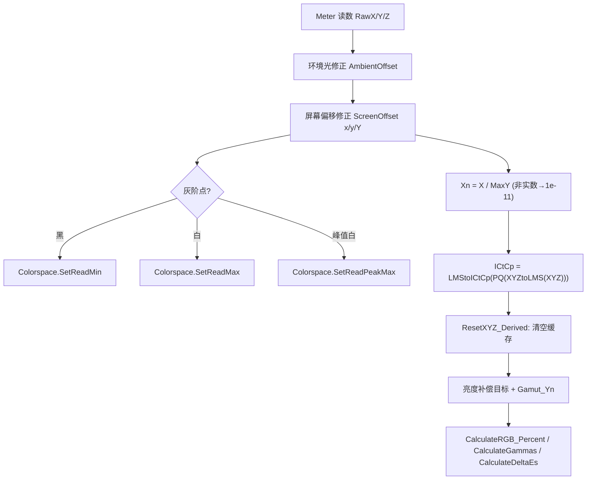
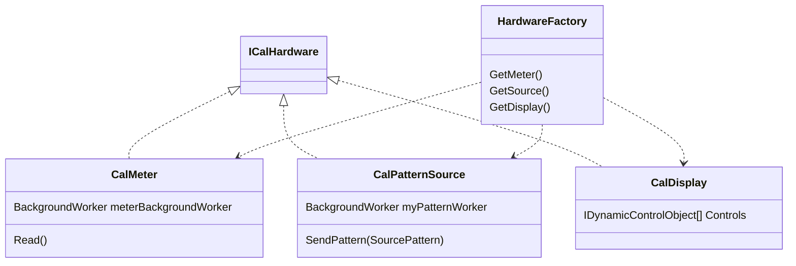

# CalIO.dll 架构与算法复刻技术文档（v2 · 已对照导出源码核对）

> [!NOTE]
> 本版基于 dnSpy 导出的源码 `code\CalIO`（共 819 个 `.cs`）逐项核对，修正了 v1（仅凭反射元数据推测）中的多处错误。第九节为**勘误表**。
> 范围限定为色彩科学、数据模型、硬件 I/O 抽象；不涉及授权/激活逻辑。

> 发布说明：原始安装文件及反编译源码不随仓库分发；文中源码路径用于标示本地分析依据。

---

## 一、源码目录结构

| 目录 | 文件数 | 内容 |
| :--- | :---: | :--- |
| `Cal\CalIO\` | 778 | 核心：色度数据模型、`Formulas` 数学引擎、Gamma/EOTF、DeltaE、色域、硬件 I/O（Meter/Source/Display）、3D LUT 控制 |
| `Cal\CalIO\ColorSpace\` | 9 | 色域体积/镶嵌：`GamutVolume`、`GamutRingVolumes`、`Tesselation`、`Tri`、`Vertice`、`RGB_XYZ_LAB`、`CylindricalData` |
| `ConvexHull\` | 29 | 内嵌的 **MIConvexHull** 库：`ConvexHull`、`DelaunayTriangulation`、`VoronoiEdge` 等，用于 3D 色域体积与 LUT 几何 |
| `Properties\` | 1 | 程序集信息 |

**复刻优先阅读的关键文件：**

| 文件 | 作用 |
| :--- | :--- |
| `Cal/CalIO/Formulas.cs` | 静态数学引擎（≈2738 行）：xyY/uv/Lab/Luv、全部 ΔE、ICtCp、JND、CCT、RGB↔XYZ、自写 3×3 矩阵运算 |
| `Cal/CalIO/CalculationPoint.cs` | 单个测量点的**计算核心**（≈3874 行）：环境光/屏幕偏移修正、目标值生成、ΔE 汇总 |
| `Cal/CalIO/MeasureDataPoint.cs` | 面向 UI/工作流的包装层（绑定、事件），内部委托给 `CalculationPoint` |
| `Cal/CalIO/Colorspace.cs` | 一个"色彩空间会话"：Min/Max/Peak 亮度、目标色域与 Gamma、计算点缓存 |
| `Cal/CalIO/ColorspacePublic.cs` | RGB → `ulong` 索引编码 |
| `Cal/CalIO/FourColorMatrix.cs` / `Cal/CalIO/FourColorDriftCorrection.cs` | 探头四色矩阵校正 / 时间漂移插值 |
| `Cal/CalIO/CalGamut.cs` / `Cal/CalIO/GamutCalculator.cs` | 目标色域、二次色推导、原色 Yn 求解 |
| `Gamma_*.cs`（21 个） | EOTF：`Cal/CalIO/Gamma_ITU1886.cs`、`Cal/CalIO/Gamma_ST2084.cs`、`Cal/CalIO/Gamma_BT2390_EETF.cs`、`Gamma_HLG`、`Gamma_sRGB`、`GammaDICOM`、`GammaPower`、`GammaL_Star`、`Gamma_ST2084_EETF` 等 |
| `Cal/CalIO/CalMeter.cs` / `Cal/CalIO/CalPatternSource.cs` / `Cal/CalIO/CalDisplay.cs` | 硬件抽象：探头 / 信号源 / 显示器控制 |
| `Cal/CalIO/CubeLUT_Control.cs` | 3D LUT 点集管理 |

> [!IMPORTANT]
> `CalIO.dll` **没有**使用 MathNet.Numerics。所有 3×3 矩阵运算都在 `Formulas` 中手写：`CreateInverseMatrix`（行列式+伴随矩阵）、`CalculateMatrixInverse`（Gauss-Jordan）、`MultiplyMatricies`；`GamutCalculator.SolveForXYZ` 用高斯消元。复刻时可自由选择 MathNet 或手写。

---

## 二、数据模型（已按源码修正）

### 1. `XYZ` —— 绝对三刺激值（**不可变 struct**）
源码：`Cal/CalIO/XYZ.cs`

```csharp
public struct XYZ : IXYZ, IEquatable<IXYZ>
{
    public double X { get; private set; }   // cd/m² 量纲
    public double Y { get; private set; }
    public double Z { get; private set; }
    public double IR1 { get; private set; } // 探头附加通道（部分仪器）
    public double IR2 { get; private set; }

    public XYZ(double X, double Y, double Z);
    public XYZ(IXnYnZn normalizedXYZ, double maxY); // 反归一化：X = Xn * maxY ...
    public XYZ(IxyY xyY);
    // 重载 + - == !=
}
```

### 2. `XnYnZn` —— 相对 peak 归一化的三刺激值
源码：`Cal/CalIO/XnYnZn.cs`

```csharp
public struct XnYnZn : IXnYnZn, IEquatable<IXnYnZn>
{
    public double Xn, Yn, Zn { get; private set; }     // Yn: 白场 = 1.0
    public XnYnZn(double Xn, double Yn, double Zn);     // 非实数(NaN/Inf)分量被忽略→保持 0
    public XnYnZn(IXYZ xyz, double maxY);               // Xn = X / maxY ...
    public XnYnZn(double X, double Y, double Z, double maxY);
    public static XnYnZn From_xyYn(double x, double y, double Yn); // 调用 Formulas.XZ
}
```

> [!TIP]
> Calman 的绝大多数色度公式（Lab、Luv、ΔE、RGB↔XYZ）都在 **归一化空间**（`Yn∈[0,1]`）中计算，只有 ICtCp/PQ/JND 这类绝对亮度相关公式才用绝对 `XYZ`（nit）。复刻时建议同样把两种类型严格分开，避免量纲混用。

### 3. RGB 索引编码 —— `ulong` 48 位键
源码：`Cal/CalIO/ColorspacePublic.cs`

```csharp
public static ulong EncodeRGB_Index(ushort r, ushort g, ushort b)
    => ((ulong)r << 32) | ((ulong)g << 16) | b;   // 每通道 16 bit
public static void DecodeIndexRGB(ulong idx, out ushort r, out ushort g, out ushort b);
```
`Colorspace` / `CubeLUT_Control` 均以此为 `Dictionary<ulong, …>` 键，保证同一 RGB 码值在一个会话内只有一个计算点（`CalculationPoint` 带引用计数 `AddReference`）。

### 4. `SourcePattern` —— 图案指令
源码：`Cal/CalIO/SourcePattern.cs`

- 实现 `ISourcePatternCommandV4, ISourcePattern`。
- `RedLevel / GreenLevel / BlueLevel` 为 **`private set`**，不能直接写；设置 `Color`（`GamutColor`）、`Level`、`Is8Bit`、`IsVideoLevel` 任一属性都会触发 `private void UpdateRGB()` 重算码值。
- 黑电平地板：`Utility.GetBitFromPercent(0.0, Is8Bit, IsVideoLevel)` → 8-bit 视频 16、10-bit 视频 64、PC 全范围 0。

### 5. `CalculationPoint` / `MeasureDataPoint` —— 测量点
- `CalculationPoint`（`Cal/CalIO/CalculationPoint.cs`）是真正的计算单元，持有 `RawX/Y/Z`（仪器原始值）、修正后 `X/Y/Z`、`Xn/Yn/Zn`、`ICtCp`、`Target_*` 全套目标值、`ReadTime`、`SpectralData`，以及惰性缓存字段（`_dE2000` 等初值 `NaN`，按需计算）。
- `MeasureDataPoint`（`Cal/CalIO/MeasureDataPoint.cs`）实现 `INotifyPropertyChanged`，是 UI 绑定层，订阅 `CalculationPoint` 的 `XYZ_Derived_Updated / TargetsUpdated / PointReset` 等事件。

---

## 三、单点测量的完整计算管线（`CalculationPoint`）



关键细节（源码 `UpdateMeasures` 附近）：

1. **环境光修正**：若仅设置了 `AmbientOffset_Y`（X、Z 为 0），按比例缩放 `k = (RawY + offY) / RawY`，三通道同乘 `k`（保持色品不变）；否则三通道分别加偏移。
2. **屏幕偏移**：转成 `xy` 后加 `ScreenOffset_x/y`，`Y *= ScreenOffset_Y`，再由 `Formulas.XZ` 反算 X、Z（用于投影幕增益/色偏补偿）。
3. **亮度补偿目标（Luminance Compensated）**：`k = Yn / Target_Yn`，`LC_Target = (Target_Xn·k, Yn, Target_Zn·k)`——即**忽略亮度误差、只看色度误差**的 ΔE，对应 UI 中 "dE (Luminance Compensated)"。
4. **RGB 百分比误差**：`CalculateAbsolutePercent(meas, target) = L*(meas) − L*(target) + 100`，其中 `L*` 由 `Formulas.Yn_To_L` 计算（以 L* 差表达通道误差，100 表示完美）。
5. **汇总**：`dEMax` = max(dE76 Lab, dE76 Luv, dE94, dE2000, dE ICtCp 240/720, dEuv, dEuvDiff)；`dECalibrationMax` 额外包含 dE94 的 L/C/H 分量。

---

## 四、探头校正：四色矩阵（`FourColorMatrix`）

源码：`Cal/CalIO/FourColorMatrix.cs`

> [!WARNING]
> 参数顺序是 **White 在前**：`CalculateMatrix(refWhite, refRed, refGreen, refBlue, measWhite, measRed, measGreen, measBlue)`。v1 文档写成 W 在第四位，是错误的。

### 算法（与源码一致）
1. `ConvertTo_xyz_Array_flip`：将 R、G、B 三刺激值转为**色品坐标** `(x, y, z)`（`Formulas.xyz`），作为 3×3 矩阵的**列**：

$$P = \begin{bmatrix} x_R & x_G & x_B \\ y_R & y_G & y_B \\ z_R & z_G & z_B \end{bmatrix}$$

2. `Gen_RGB_Matrix(P, white)`：白点也转为色品 `w = (x_W, y_W, z_W)`，求权重 `k = P⁻¹·w`，返回 `N = P·diag(k)`。
3. `CalculateColor`：

$$M_0 = N_{\text{ref}} \cdot N_{\text{meas}}^{-1}$$

4. **亮度归一化（v1 遗漏）**：用色品而非绝对值构建矩阵会丢失亮度尺度，因此整矩阵乘以

$$s = \frac{Y_{W,\text{ref}}}{M_0[1,0]X_{W,\text{meas}} + M_0[1,1]Y_{W,\text{meas}} + M_0[1,2]Z_{W,\text{meas}}}, \qquad M = s \cdot M_0$$

   使校正后的白场 Y 精确等于参考仪器白场 Y。

```csharp
// 复刻参考（无外部依赖）
public static double[,] FourColor(XYZ rW, XYZ rR, XYZ rG, XYZ rB,
                                  XYZ mW, XYZ mR, XYZ mG, XYZ mB)
{
    double[,] Nref  = GenRgbMatrix(Chroma(rR, rG, rB), ChromaVec(rW));
    double[,] Nmeas = GenRgbMatrix(Chroma(mR, mG, mB), ChromaVec(mW));
    double[,] M = Mul(Nref, Inv3(Nmeas));
    double s = rW.Y / (M[1,0]*mW.X + M[1,1]*mW.Y + M[1,2]*mW.Z);
    for (int i = 0; i < 3; i++) for (int j = 0; j < 3; j++) M[i,j] *= s;
    return M;
}
static double[,] GenRgbMatrix(double[,] P, double[] w)
{
    double[] k = MulVec(Inv3(P), w);
    var N = new double[3,3];
    for (int i = 0; i < 3; i++) for (int j = 0; j < 3; j++) N[i,j] = P[i,j] * k[j];
    return N;
}
// Chroma(): 列 = (X,Y,Z)/(X+Y+Z)；ChromaVec(): 同上的向量
```

### 漂移补偿 `FourColorDriftCorrection`
源码：`Cal/CalIO/FourColorDriftCorrection.cs`
在长时间 3D LUT 采集首尾各做一次四色测量，按测量点的 `ReadTime` 在两个矩阵间**线性插值**，补偿面板热漂移。复刻时：`t = (T − T0)/(T1 − T0)`，`M(t) = (1−t)·M0 + t·M1`。

---

## 五、`Formulas` 数学引擎要点

源码：`Cal/CalIO/Formulas.cs`；`DeltaEs`（`Cal/CalIO/DeltaEs.cs`）只是以 `(measured, target, whitePoint, maxY)` 初始化的容器，所有计算都委托给 `Formulas`。

### 1. 色差家族

| 方法 | 公式 / 说明 |
| :--- | :--- |
| `DeltaE1976` | Lab 或 Luv 欧氏距离（同一签名复用） |
| `DeltaE1994` | 同时输出带符号的 `dL / dC / dH` 分量（`Signed_dE94_*`） |
| `DeltaE2000` | 标准 CIEDE2000（kL=kC=kH=1），v1 中的参考实现可继续使用 |
| `DeltaE2000_JND_Hybrid` | **Calman 特有**：把 CIEDE2000 中的 ΔL 项替换为 DICOM GSDF 的 JND 差（`Y_To_JND`），用于医疗/低亮度场景 |
| `dE_ICtCp_240` | $\sqrt{\Delta I^2 + 0.25\,\Delta C_T^2 + \Delta C_P^2}\times 240$（Calman 旧版刻度） |
| `dE_ICtCp_720` | 同上 ×720，即 ITU-R BT.2124 的 $\Delta E_{ITP}$ |
| `DeltaEuv` | $1300\sqrt{(u'-u'_t)^2+(v'-v'_t)^2}$；`u` 或 `v` 为 0 时返回 0 |
| `DeltaEuvDiff` | `max(|Δu'|, |Δv'|)` |
| `DeltaE_uv_TG18` | AAPM TG18：$\sqrt{\Delta u'^2+\Delta v'^2}$（不放大） |
| `DeltaEJND` | `|JND − JND_target|` |

> [!NOTE]
> `0.25·ΔCt²` 等价于 BT.2124 中先把 Ct 乘 0.5 再求欧氏距离；`Formulas.XYZtoICtCp_PQ_Scaled_240/720` 正是返回 `(I·k, Ct·k·0.5, Cp·k)`。

### 2. ICtCp（BT.2100）
```text
XYZtoLMS_matrix = CrossTalk4 × XYZtoLMS_RawMatrix      // 静态初始化（实际使用的矩阵）
LMStoXYZ_matrix = CreateInverseMatrix(XYZtoLMS_matrix)

CrossTalk4 = [[0.92, 0.04, 0.04],
              [0.04, 0.92, 0.04],
              [0.04, 0.04, 0.92]]                         // BT.2100 的 4% 串扰

XYZtoLMS_RefMatrix = [[ 0.38971, 0.68898, -0.07868],      // Hunt-Pointer-Estevez（另一个字段，
                      [-0.22981, 1.18340,  0.04641],      //  非 ICtCp 主路径所用）
                      [ 0.0,     0.0,      1.0    ]]

LMS' = NitsToPQPerc(L, M, S)          // ST 2084 编码，输入单位 nit

LMStoICtCp_Matrix = [[0.5,          0.5,          0.0        ],
                     [1.613700009, -3.323396143,  1.709696134],
                     [4.378062447, -4.245539799, -0.132522648]]   // = BT.2100 的 (2048,2048,0)/4096 ...
ICtCp = LMStoICtCp_Matrix × LMS'
```
注意输入必须是**绝对** `XYZ`（nit），`CalculationPoint` 在 `UpdateTargets` 中用 `new XYZ(targetXnYnZn, MaxY)` 反归一化后再算目标 ICtCp。

### 3. 亮度 / L*
`Yn_To_L`：阈值 `ε = 0.008856451679035631`（=216/24389），`κ = 903.2962962962963`（=24389/27），与 CIE 精确常数一致，并对负值取 `|Yn|`。

### 4. DICOM GSDF JND
- `JND_To_Y`：DICOM PS3.14 有理多项式（常数 `DICOM_a`…`DICOM_m`）。
- `Y_To_JND`：无解析逆，使用二分查找 `Find_JND_Recursive`。

### 5. 相关色温
- `CCT`：McCamy 三次近似，$n = (x-0.3320)/(0.1858-y)$，$CCT = 437n^3 + 3601n^2 + 6831n + 5517$。
- `CCTxy`：Kang 等人近似（由 CCT 反求 xy）。
- `CCT_DSeries`：普朗克 / D 系列光谱积分（360–830 nm，5 nm 步长）。

### 6. RGB ↔ XYZ
- `XYZtoRGB_(IXnYnZn, IGamutConversionSpace)` → `LinearRGB`；带 `IGammaFormula` 的重载返回 `StimulusRGB`（已编码信号）。
- `RGBtoXYZ_(LinearRGB, gamut, maxY)` / `RGBtoXYZ_(StimulusRGB, gamut, formula, min, max)`。
- `GetGamutYnMax(x, y, gamut, maxY, minYn)`：给定色品在目标色域内可达到的最大 Yn，用于 `Gamut_Yn`（饱和度扫描的相对亮度）。

---

## 六、Gamma / EOTF（`IGammaFormula`）

统一接口：
```csharp
interface IGammaFormula {
    double EOTF(double stimulusPercent, double minY, double maxY);   // 信号→归一化亮度
    double OETF(double linearLight, double minY, double maxY);       // 归一化亮度→信号
    double PointGamma(...);  double LinearizePointGamma(...);
    double GetReferenceY_FromPeakY(...);
}
```

### 1. BT.1886（`Cal/CalIO/Gamma_ITU1886.cs`）
- 公式 $L = a\cdot\max(V+b,0)^{\gamma}$，`a = Get_a(maxY, minY, γ)`、`b = Get_b(maxY, minY, γ)`，与 v1 推导一致。
- **修正点**：
  - `γ` 是实例字段 `this.y`，**可配置**（默认 2.4），不是常量；
  - 对 `V+b < 0`（低于黑电平的信号）做**镜像负值**处理：$L = -a\cdot(-(V+b))^{\gamma}$；
  - `EOTF` 返回的是 `L / maxY`（范围 `[minY/maxY, 1]`），`Formulas.LinearizeGammaNoOffset` 再归一化为 `(L − minY/maxY)/(1 − minY/maxY)`；
  - `PointGamma` = `log10(L/a) / log10(V+b)`（"逐点 Gamma"，Calman 灰阶图的 Gamma 曲线即此值）；
  - `GetRef_FromPeak` 用迭代法根据某一实测点反推等效白电平（`bestGuessMax`）。

### 2. SMPTE ST 2084 PQ（`Cal/CalIO/Gamma_ST2084.cs`）
常数：`m1 = 0.1593017578125`、`m2 = 78.84375`、`c1 = 0.8359375`、`c2 = 18.8515625`、`c3 = 18.6875`、`ReferenceMaxY = 10000`。
`NitsToPQPerc(nits)` 即标准逆 EOTF，被 ICtCp 与 HDR 灰阶目标复用。

### 3. BT.2390 EETF 色调映射（`Cal/CalIO/Gamma_BT2390_EETF.cs`）
在 PQ 域执行：
1. 归一化源信号到 `[0,1]`（相对母版峰值/黑）；
2. 拐点 `KS = 1.5·maxLum − 0.5`；`E > KS` 区段使用 Hermite 样条 `P(B, KS, maxLum)` 压缩到显示器峰值；
3. 黑电平抬升：`E' = E + minLum·(1 − E)^4`；
4. `OETF` 无解析逆，使用二分查找 `FindEncodedGammaRecursive`。

其余实现：`Gamma_HLG(_Manual)`、`Gamma_sRGB`、`GammaPower`、`Gamma_SlidingPower`、`GammaL_Star`、`GammaDICOM`、`GammaEPD2/3`、`Gamma_Custom / Gamma_AbsoluteCustom`、`Gamma_ST2084_EETF`，由 `GammaFormulaGenerator` 按枚举 `GammaFormulas` 创建。

---

## 七、色域计算（`CalGamut` / `GamutCalculator`）

- `CalGamut` 保存目标 R/G/B/W 色品；`CalGamut.GetD65()` 提供 Rec.709/D65 默认值（也被 UI 对比色块使用）。
- **二次色推导** `PopuluateSecondaries()`：Cyan/Magenta/Yellow 色品 = "白点→某原色"连线的反向延长线与对边（另两原色连线）的**线段交点**。
- **原色 Yn 求解** `PopulateYn()` / `SolveForXYZ`：解 $\sum k_i\,(x_i/y_i, 1, z_i/y_i) = W$ 的线性方程（高斯消元），得到各原色相对亮度——即标准 NPM（RGB→XYZ）矩阵的推导。
- 3D 色域体积：`ColorSpace\GamutVolume` + `Tesselation` + `ConvexHull\*`（Lab 空间凸包/环形体积 `GamutRingVolumes`）。

---

## 八、硬件抽象层与 3D LUT（真实架构）



- **并发模型**：使用 `BackgroundWorker` + 事件回调（.NET 2.0 风格），而**不是** `Task/async`。
- **驱动来源**：`HardwareFactory` 只负责创建包装对象，真正的仪器协议位于 `CalAppPlatform` / `PDInst` 及 COM 驱动中，**不在 CalIO 内**。若要复刻仪器通信，需另行研究这些程序集，或使用 ArgyllCMS（`spotread`）等开源驱动。
- **动态控件**：显示器/源的可调项通过 `IDynamicControlObject` 暴露（`BoolDisplayControl`、`RangedDisplayControl`、`EnumDisplayControl`、`ButtonDisplayControl`），UI 依此自动生成控制面板。
- **3D LUT**：`CubeLUT_Control` 用 `BitArray`（8-bit 长 256 / 10-bit 长 1024）标记每轴启用的码值，点集存于 `Dictionary<ulong, CubeLUT_Point>`，键由 `EncodeRGB_Index` 生成。

### 复刻建议的现代接口
```csharp
public interface IMeter : IAsyncDisposable {
    Task<XYZ> ReadAsync(CancellationToken ct);
}
public interface IPatternSource : IAsyncDisposable {
    Task ShowAsync(SourcePattern p, CancellationToken ct);
}
public sealed class MeasureLoop(IMeter meter, IPatternSource src, TimeSpan settle) {
    public async Task<XYZ> ShowAndReadAsync(SourcePattern p, CancellationToken ct) {
        await src.ShowAsync(p, ct);
        await Task.Delay(settle, ct);          // 面板稳定时间
        return await meter.ReadAsync(ct);       // 之后再套四色矩阵 / 环境光修正
    }
}
```

---

## 九、勘误表（v1 → v2）

| # | v1 内容 | 源码实际 |
| :---: | :--- | :--- |
| 1 | `XYZ` 是 `class`，属性可写 | `struct XYZ`，`private set`，不可变；另有独立的 `XnYnZn` 归一化类型 |
| 2 | `SourcePattern.RedLevel` 等可直接赋值 | `private set`，由 `UpdateRGB()` 根据 `Color/Level/Is8Bit/IsVideoLevel` 自动计算 |
| 3 | 四色矩阵参数顺序 R,G,B,W | **W,R,G,B**（ref 组在前，meas 组在后） |
| 4 | 四色矩阵直接用 XYZ 构建 | 用**色品 xyz** 构建，最后乘亮度归一化系数 `s` |
| 5 | 依赖 MathNet.Numerics | 未使用，矩阵运算全部手写于 `Formulas` |
| 6 | BT.1886 γ 固定 2.4 | γ 可配置；支持负信号镜像；EOTF 返回 `L/maxY` |
| 7 | 只提到 dE2000 | 实际同时计算 dE76(Lab/Luv)、dE94(含带符号分量)、dE2000、JND-Hybrid、ICtCp 240/720、Δu′v′ 三种、JND，并有"亮度补偿"版本 |
| 8 | 硬件接口为 async/Task | `BackgroundWorker` + 事件；协议实现在 `CalAppPlatform`/`PDInst`，不在 CalIO |
| 9 | 一节"如何导出源码" | 已导出完成，删除该节 |
| 10 | 未提及测量修正管线 | 补充环境光 / 屏幕偏移修正、Min/Max/Peak 自动登记（第三节） |

---

## 十、复刻路线（更新）

| 阶段 | 任务 | 对应源码 |
| :---: | :--- | :--- |
| 1 | `XYZ`/`XnYnZn`/xyY/u′v′/Lab/Luv 基础转换 + 3×3 矩阵 | `XYZ.cs`、`XnYnZn.cs`、`Formulas.cs` |
| 2 | 色域 NPM 矩阵、二次色、`GetGamutYnMax` | `CalGamut.cs`、`GamutCalculator.cs` |
| 3 | EOTF：BT.1886 / PQ / HLG / BT.2390 / sRGB | `Gamma_*.cs` |
| 4 | 全套 ΔE + ICtCp + JND + CCT | `Formulas.cs`、`DeltaEs.cs` |
| 5 | 测量点管线（环境光、亮度补偿、汇总） | `CalculationPoint.cs`、`Colorspace.cs` |
| 6 | 四色矩阵 + 漂移插值 | `FourColorMatrix.cs`、`FourColorDriftCorrection.cs` |
| 7 | 仪器驱动（ArgyllCMS / 厂商 SDK）与图案源 | `CalMeter.cs`、`CalPatternSource.cs`（仅参考抽象） |
| 8 | 3D LUT 采样、插值与色域体积 | `CubeLUT_Control.cs`、`ColorSpace\*`、`ConvexHull\*` |

> [!TIP]
> 建议用导出源码做"金标准"单元测试：在 .NET Framework 4.8 测试工程中引用原 `CalIO.dll`，对同一组输入比较你的实现与 `Formulas.DeltaE2000`、`Gamma_ITU1886.EOTF`、`FourColorMatrix.CalculateMatrix` 的输出（误差 < 1e-9）。
