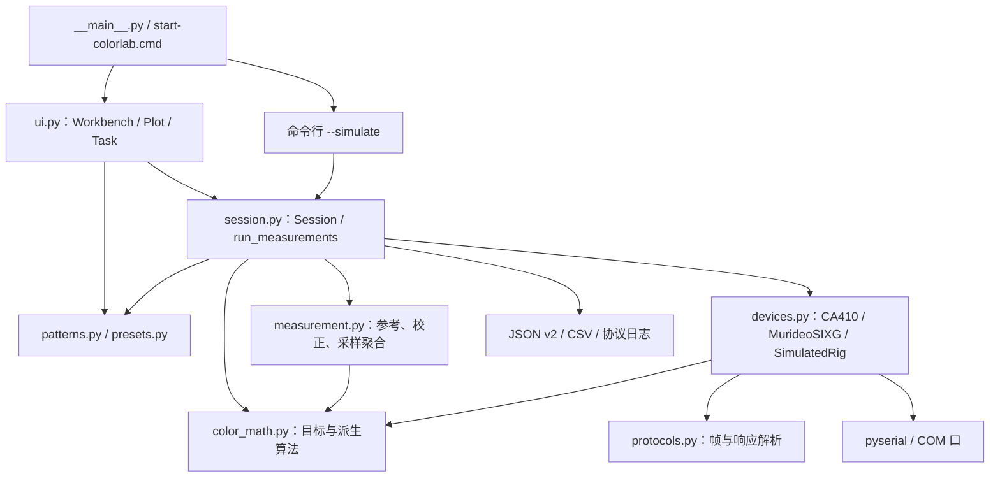
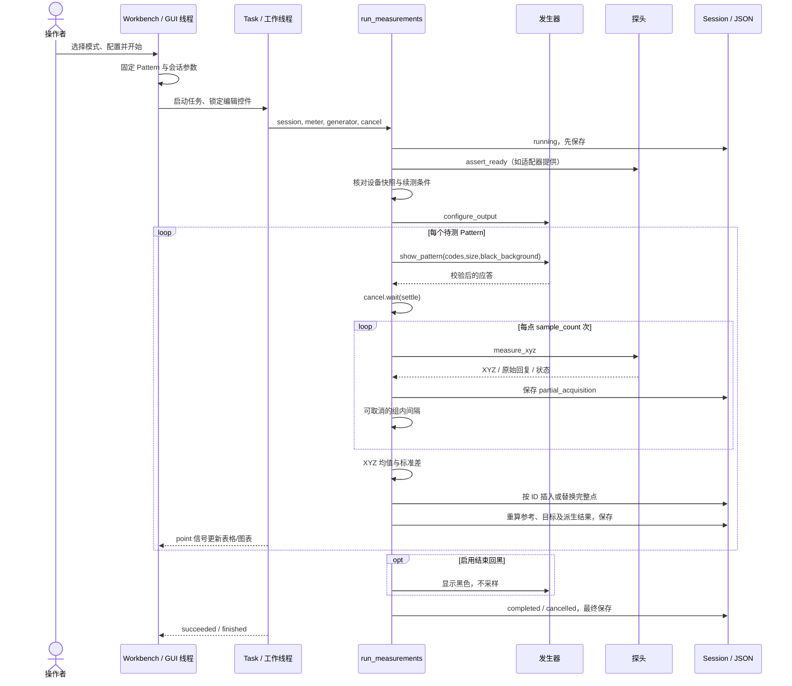
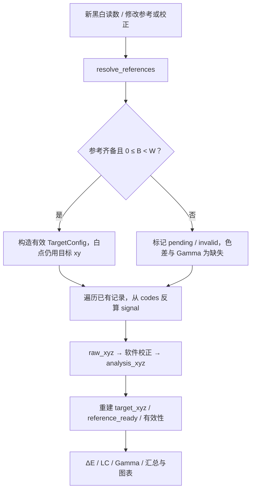
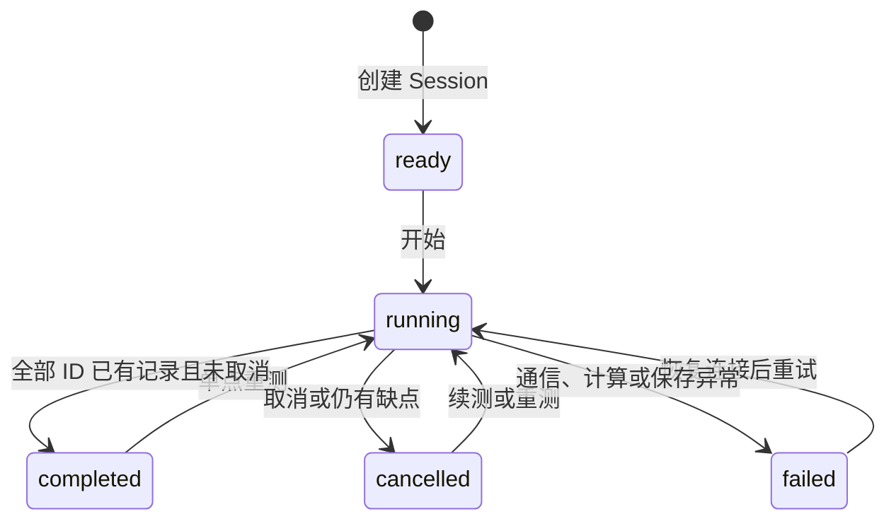
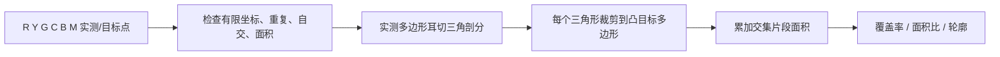
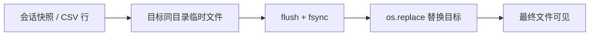

# CalmanSim / ColorLab 详细设计文档

版本：1.0；核对日期：2026-11-08；对象：`calman_py` 当前实现，应用包版本 `0.1.0`。

本文面向继续开发、算法复核和仪器联调。其结构参考 [CalIO 架构与 API 指南](../CalIO_Architecture_and_API_Guide.md)，实现事实以 Python 源码为准。原指南描述的 Calman 能力不自动等于本工程已经具备的能力；原 DLL 不参与本工程运行。

## 阅读导航

- 架构与数据：[1. 范围](#1-范围与设计约束)、[2. 模块架构](#2-模块架构)、[3. 数据与单位](#3-数据模型与单位)。
- 流程：[4. 测量流程](#4-测量流程)、[5. 状态与并发](#5-状态与并发)、[6. Pattern](#6-pattern-生成与码值)。
- 算法：[7. 目标与 EOTF](#7-目标-xyz-与-eotf)、[8. 色度与色差](#8-色度变换与色差)、[9. Gamma](#9-gamma-指标与汇总)、[10. 色域](#10-六点色域面积与覆盖率)、[11. 校正](#11-探头软件校正与四色矩阵)、[12. 辅助指标](#12-rgb-平衡cct-与-ictcpitp)。
- 接口与工程：[13. 设备通信](#13-设备通信设计)、[14. 持久化](#14-会话文件与-csv)、[15. UI](#15-界面与结果呈现)、[16. API](#16-关键-api-契约)、[17. 验证](#17-验证方案与数值样例)、[18. 差异与扩展](#18-与-calio-的差异及扩展边界)。

## 1. 范围与设计约束

### 1.1 已实现范围

| 领域 | 当前能力 |
|---|---|
| 运行方式 | Windows Qt 桌面界面；命令行无界面模拟测量 |
| 仪器 | CA410 USB 虚拟串口适配器；传统 Murideo SIX-G/GEN2 串口适配器；耦合模拟设备 |
| 信号 | SDR、RGB；计算/模拟支持 8/10 bit、Full/Limited；SIX-G 实机只接收 8 bit |
| 测量序列 | 七点色域；含端点的可配置点数灰阶；39 点色准；单点重测 |
| 目标 | 六种色域预设、独立白点、Power/sRGB/BT.1886；从实际码值推导目标 |
| 计算 | XYZ、xyY、u′v′、Lab、Luv；ΔE76/94/2000、亮度补偿、ICtCp/ITP；三种 Gamma、RGB 平衡、CCT |
| 校正与采样 | 导入 XYZ 矩阵或八组四色读数；重复采样、原始样本留存、配置重算 |
| 会话 | 自动保存、取消续测、部分采样保存、JSON v1/v2、CSV |
| 色域 | 六点有序多边形面积、与目标的交集覆盖率，分别在 xy/u′v′ 中计算 |

### 1.2 必须保持的行为

1. 灰阶只发送 R=G=B 的色块；点数包含黑白端点，默认 17，可选 33 等。
2. 色域只采集白、R、G、B、C、M、Y 七点；面积使用 R→Y→G→C→B→M 六点，白点不进入面积。
3. 色准使用当前完整 39 点；不把未来的 SG、Video 等集合冒充为已实现。
4. 实测参考缺失不自动补打色块。可选结束回黑是辅助显示，不计入测量点数。
5. 原始码值、原始 XYZ 和逐次采样是事实数据；校正和参考切换只更新派生结果。
6. 设备超时或无效回复不转换为成功读数，不自动重发测量/零校准命令。

### 1.3 环境与验证级别

Python ≥3.11，NumPy ≥1.24 且 <3，pyserial ≥3.5 且 <4，PySide6-Essentials ≥6.6 且 <7。依赖与入口由 [pyproject.toml](../pyproject.toml) 定义；测试使用 pytest。

目前已完成静态协议分析、模拟测量和假串口测试。真实 CA410/SIX-G、不同固件和 HDMI 实际输出仍须联调。代码提供连接能力，不构成“设备兼容性已验证”的结论。

## 2. 模块架构



| 模块 | 职责与主要接口 | CalIO 对应概念 |
|---|---|---|
| [presets.py](../calman_py/presets.py) | 色域、白点、模拟面板参数 | CalGamut、白点与设备预设 |
| [patterns.py](../calman_py/patterns.py) | 固定色块库、灰阶生成、模式分派 | ColorCheckerSource、GrayscaleCollection |
| [color_math.py](../calman_py/color_math.py) | 无硬件依赖的数值函数、TargetConfig | Formulas、Gamma_*、Colorspace 目标变换 |
| [measurement.py](../calman_py/measurement.py) | MeasurementOptions、参考解析、XYZ 校正、均值/标准差 | 测量策略及部分 CalculationPoint 预处理 |
| [protocols.py](../calman_py/protocols.py) | ASCII/二进制编解码、状态与错误类型 | 原生驱动协议边界 |
| [devices.py](../calman_py/devices.py) | 连接、配置、测量、显示色块、设备快照 | CalMeter / CalPatternSource 包装 |
| [session.py](../calman_py/session.py) | 流程编排、记录、重算、统计、持久化 | Colorspace、CalculationPoint、测量集合 |
| [ui.py](../calman_py/ui.py) | 任务线程、模式选择、参数编辑、表格/图表 | MeasureDataPoint、UI/Workflow |
| [__main__.py](../calman_py/__main__.py) | GUI / 模拟 CLI 入口 | 应用启动层 |

设计采用组合，不直接复制 CalIO 的类层次、事件系统和 48 位 RGB 索引。Python 使用字符串 Pattern ID 定位记录，同一会话内按 ID 更新单点；不同 ID 即使 RGB 相同也不自动合并。

原指南对矩阵运算的描述用于理解算法；当前工程实际使用 NumPy 的 `solve`、`inv` 和矩阵乘法。不要据此推断原程序集的所有功能都使用同一矩阵实现。

## 3. 数据模型与单位

### 3.1 记号约定

| 记号/字段 | 含义 | 单位或范围 |
|---|---|---|
| `codes=(cR,cG,cB)` | 实际发送的整数 RGB | 取决于位深和信号范围 |
| `signal=(sR,sG,sB)` | 从实际码值反算的编码信号 | 每通道 [0,1]，尚未线性化 |
| `raw_xyz` | 完整重复采样组的原始 XYZ 均值 | 绝对三刺激量，Y 为 cd/m²，即 nit |
| `analysis_xyz` | 对原始均值施加软件校正后的 XYZ | 同上 |
| `target_xyz` | 从实际信号与参考条件生成的目标 XYZ | 同上；参考未就绪时只是临时计算值 |
| `x,y` | 色品坐标 | 无量纲，分母为 X+Y+Z |
| `Xn,Yn,Zn` | 相对白场 W 的归一化 XYZ | 无量纲；本工程通常临时计算，不作为独立类保存 |
| `B,W` | 本次分析采用的黑/白亮度参考 | nit，0≤B<W |
| `M` | RGB→相对 XYZ 的 3×3 矩阵 | 列为三个原色对白点的贡献 |
| `ε,κ` | Lab/Luv 分段常数 | 216/24389、24389/27 |

小写 `target_x/target_y` 是色品；JSON/CSV 的大写目标 X/Y/Z 是三刺激值。不能把 RGB 编码信号当作线性光，也不能把相对白亮度 `Yn` 当作信号百分比。

### 3.2 TargetConfig

不可变 dataclass，负责目标条件。默认值与代码一致：

| 字段 | 默认值 | 校验/用途 |
|---|---|---|
| `gamut` | `rec709` | 支持 rec709、p3、dcip3、rec2020、adobe、ntsc1953 |
| `white_xy` | (0.312713, 0.329016) | 独立目标白点；必须使原色亮度权重均为正 |
| `gamma` | `power` | power / srgb / bt1886 |
| `exponent` | 2.2 | 0<值≤10；只控制 Power |
| `black`, `white` | 0、100 | 有限值且 0≤black<white |
| `bit_depth` | 8 | 8 或 10 |
| `range` | `full` | full / limited |
| `round_percent` | true | 非精确码值 Pattern 的信号先按整数百分比取整 |

会话保存的 `config` 是用户配置；实测参考产生的有效配置在 `summary.analysis_config` 中输出。两者不得混写，以保留手动值及参考来源。

### 3.3 MeasurementOptions

同样为不可变 dataclass。改变策略时使用 `dataclasses.replace`。

| 字段 | 默认值 | 含义 |
|---|---|---|
| `black_reference` | manual | manual / measured / auto |
| `white_reference` | manual | manual / measured |
| `include_black` | false | 黑场是否参与色差平均/最大值 |
| `gamma_metric` | point | point / absolute / effective；影响展示与 `gamma_mean` 选择 |
| `sample_count` | 1 | 每点 1–100 次采样 |
| `sample_interval` | 0 | 组内采样间隔 0–60 秒 |
| `end_black` | false | 成功结束/取消后发送辅助全场黑 |
| `correction_name` | 空字符串 | 软件校正名称，最长 200 字符 |
| `correction_matrix` | 单位矩阵 | 有限的 3×3 矩阵 |
| `correction_offset` | (0,0,0) | 有限的三项绝对 XYZ 偏移 |
| `legacy` | false | v1 会话兼容口径标记 |

### 3.4 测量记录

记录是字典。完整采样成功后才插入或替换 `Session.records`。

| 字段 | 内容 |
|---|---|
| `pattern` | Pattern 定义快照，含 ID、类型、标签和原始定义 |
| `codes`, `signal` | 实际整数码值、反算信号 |
| `raw_xyz`, `analysis_xyz`, `target_xyz` | 原始均值、分析值、目标值 |
| `samples` | 每次 `xyz/raw/status/probe/warnings/timestamp` |
| `sample_count`, `xyz_stddev` | 组内样本数、三个 XYZ 分量的标准差 |
| `raw_response`, `timestamp`, `warnings` | 多次回复按换行拼接、记录时间、去重后的警告 |
| `reference_ready` | 黑白参考是否齐备且有效 |
| `measurement_valid` | 全部原始样本、均值及校正值是否均无负 XYZ |
| `delta_e`, `delta_e_lc` | 色差字典；不能计算时为 null |

`measurement_valid` 与 `reference_ready` 是两个维度：读数有效不代表参考已齐备。已获取的有限负 XYZ 仍保存原文及数值，但不以裁零、删样本等方式参与有效统计。

## 4. 测量流程

### 4.1 端到端时序



### 4.2 连接与就绪

1. UI 分别创建 CA410 与 SIX-G，连接失败则清理已建立的连接；模拟模式用同一个 `SimulatedRig` 同时担任探头与发生器。
2. CA410 连接阶段发送明确的测量条件，再读取身份与状态。连接成功与可开始测量是不同状态；任务开始还会执行 `assert_ready()`。
3. 零校准由用户切换探头至 ZERO 后主动发起；完成后切回 MEASURE。程序不自动移动探头或假定物理开关位置。
4. 已连接时禁止修改实机通道、同步、速度等参数；改变配置须先断开重连。

### 4.3 执行、采样和部分结果

`planned` 在工作函数进入时由会话 Pattern 快照解析。每点先显示，等待稳定，然后采样；不会把上一色块的读数作为下一点。测量期间切换页签只改变下一次工作流选择，不改变当前快照。

第 j 次读数通过形状及有限性校验后，立即写入 `metadata.partial_acquisition` 并尝试保存。若组内取消或超时，该组不会替换已有完整记录；采样完成后才计算均值、创建记录、清除部分组并重算。

设每点采样数为 n，对三个 XYZ 分量分别计算：

$$\bar{\mathbf X}=\frac1n\sum_{j=1}^{n}\mathbf X_j,$$

$$\sigma_c=\sqrt{\frac{\sum_j(X_{j,c}-\bar X_c)^2}{n-1}}\quad(n>1).$$

n=1 时标准差取 0。先平均 XYZ，再求色品和色差；不平均 xy、Gamma 或 ΔE。软件矩阵作用于原始均值；对固定仿射矩阵，其结果等价于先逐样本校正再求均值。

### 4.4 取消、续测和单点重测

- `threading.Event` 使稳定等待、组内等待可提前结束；正在执行的串口读不能立即中断，要等回复或超时。
- 正常续测跳过已有完整记录的 ID；半组样本保留供追溯，但续测会重新采集该点，不把两个时间段的半组拼接。
- 单点重测传入 `pattern_ids`，允许重测已有 ID。只有完整新组成功后才替换旧点；未测完的会话仍保持 `cancelled`。
- 状态是否完成取决于全部会话 Pattern 是否有记录，不单以本次筛选子集是否执行结束判断。
- 若有历史记录与设备快照，当前快照必须一致。CA410 比较身份、端口、请求及有效配置；SIX-G 当前只具备端口/驱动级检查，身份未知。

### 4.5 参考更新与重算



`auto` 黑位规则：BT.1886 取实测黑；Power/sRGB 取手动黑。实测白只提供亮度 W，不用实测白色度替换目标白点，以免掩盖白点偏色。

修改 EOTF、指数、黑白参考或软件校正会重算现有记录，原始样本和码值不变。改变色域、目标白点、位深、范围或百分比量化规则，UI 会清空当前会话映射并开始新的会话，因为这些设置可能改变应发送的码值；旧数据仍在已保存文件中。

## 5. 状态与并发

### 5.1 会话状态机



`completed` 表示采集点齐备，不表示设备精度合格，也不保证参考齐备。例如七点色域在要求实测黑位时可以采集完成，但 Gamma/色差仍等待黑场。

### 5.2 线程与锁

| 对象 | 模型 | 保护范围 |
|---|---|---|
| Workbench | GUI 主线程 | 参数、表格、图表及任务生命周期 |
| Task | 单个 QThread；同一窗口同时只运行一个任务 | 串口 I/O 与采集循环；通过 point/succeeded/failed 信号回传 |
| CA410 / SIX-G | 各自 RLock | 请求/回复串行化、关闭连接 |
| Session | 可重入锁与 `session_locked` | 重算、汇总、序列化、保存、导出及完整记录替换 |

Session 使用可重入锁，因为 `save→to_dict→summary→recalculate` 存在嵌套调用。计算缓存键包含目标配置、测量选项、记录 ID/类型、码值、原始 XYZ 和样本非负性；键变化后重算，汇总缓存随之失效。缓存不写入 JSON，也不能代替原始数据。

当前 Session 内部仍使用可变字典和列表；任意第三方并发直接修改它们不属于受支持的公共事务接口。API 使用者应沿用单个采集工作线程，并在采集之外修改分析配置。

### 5.3 失败策略

通信错误停止任务，关闭失效连接，设置 `failed/error`，最后尝试保存已有记录和协议日志。无自动重试，防止重复触发积分或零校准。保存失败会抛出异常；没有路径的内存会话调用 `save()` 不产生文件。最终保存也可能因磁盘故障失败，不能把“内存中已保留”描述成“必然已落盘”。

## 6. Pattern 生成与码值

### 6.1 模式和顺序

| 模式/页签 | 生成器 | 顺序与点数 |
|---|---|---|
| gamut / CIE xy | `build_measurement_patterns('gamut', c)` | W、R、G、B、C、M、Y，7 点 |
| grayscale / 亮度、Gamma、RGB 平衡 | `build_grayscale_patterns(N,c)` | 黑→白，N 点；三个页签共享同一灰阶会话 |
| accuracy / 色准 | `build_measurement_patterns('accuracy',c)` | 当前 `PATTERNS` 顺序，39 点 |

39 点组成：W、黑、10%–90% 的 9 个信号灰、6 个 RGB/CMY、4 个相对白亮度灰（35/50/65/80%）、18 个 Classic 彩色块。18 个彩色块的原始 xyYn 见 [patterns.py](../calman_py/patterns.py)。信号灰 50% 不等于相对白亮度灰 50%。

### 6.2 Full/Limited

| 位深 | Full `[lo,hi]` | Limited `[lo,hi]` | 最多不同灰阶码值 |
|---|---|---|---|
| 8 | [0,255] | [16,235] | Full 256；Limited 220 |
| 10 | [0,1023] | [64,940] | Full 1024；Limited 877 |

一般信号 s 的量化及反算：

$$c=lo+\operatorname{roundEven}(s(hi-lo)),\qquad s_{actual}=\frac{c-lo}{hi-lo}.$$

启用 `round_percent` 时，先令 $s\leftarrow\operatorname{roundEven}(100s)/100$。`round_even` 对距离 0.5 小于 1e-12 的值按中点取偶，否则使用 Python `round`，用于稳定浮点中点行为。

### 6.3 精确灰阶

第 i 点（i=0…N−1）：

$$c_i=lo+\operatorname{round}\!\left(\frac{i(hi-lo)}{N-1}\right),\qquad R_i=G_i=B_i=c_i.$$

灰阶保存 `exact_codes` 与 `code_format`，绕过整数百分比取整。解析时检查位深/范围一致、码值合法、Pattern 信号与码值反算结果在绝对容差 1e-12 内一致。

例如 8 bit Full、33 点：`0,8,16,…,255`；第三点码值为 16，不先把 6.25% 近似成 6%。这是工具的点数设计，不宣称是 Calman 所有默认序列。

### 6.4 xyYn/相对白亮度定义

对色块定义 $(x,y,Y_n)$，先生成相对 XYZ，再求线性原色贡献：

$$\mathbf q=M^{-1}\operatorname{XYZ}(x,y,Y_n).$$

若 q 越界，记录警告；按 $d=\max(1,\max_i q_i)$ 等比例缩放后逐通道裁到 [0,1]，再使用固定 $1/2.2$ 编码：

$$s_i=\operatorname{clip}(q_i/d,0,1)^{1/2.2}.$$

随后进行当前格式量化。`relativeGray` 的 xy 使用当前目标白点。固定 2.2 是此 SDR 色块集合的生成路径；最终目标仍按所选 EOTF 和实际发送码值重新生成，不直接采用原始色块 xyYn 作为最终目标。

## 7. 目标 XYZ 与 EOTF

### 7.1 RGB→XYZ 矩阵

对原色 $(x_i,y_i)$ 定义 $z_i=1-x_i-y_i$，构造：

$$P=\begin{bmatrix}x_R/y_R&x_G/y_G&x_B/y_B\\1&1&1\\z_R/y_R&z_G/y_G&z_B/y_B\end{bmatrix},\quad
\mathbf w=\begin{bmatrix}x_W/y_W\\1\\(1-x_W-y_W)/y_W\end{bmatrix}.$$

求 $\mathbf k=P^{-1}\mathbf w$，得到 $M=P\operatorname{diag}(\mathbf k)$。实现用 `numpy.linalg.solve`，检查每个权重大于零；白点不在原色三角形内部则拒绝。此时 $M[1,1,1]^T=\mathbf w$。

`calculate_secondaries` 对线性 RGB 的 C=(0,1,1)、M=(1,0,1)、Y=(1,1,0) 求 XYZ 和色度。它是原色混合工具，不等同于考虑非零黑位后的所有实际码值目标。

### 7.2 三种 EOTF

令 $k=B/W$，`eotf` 的返回值为相对白场的亮度 F(s)，而非 nit。

Power：

$$F(s)=k+(1-k)s^\gamma.$$

sRGB：

$$u(s)=\begin{cases}s/12.92&s\le0.04045\\((s+0.055)/1.055)^{2.4}&s>0.04045\end{cases},\qquad F(s)=k+(1-k)u(s).$$

BT.1886：

$$a=(W^{1/2.4}-B^{1/2.4})^{2.4},\quad b=\frac{B^{1/2.4}}{W^{1/2.4}-B^{1/2.4}},\quad F(s)=\frac{a(s+b)^{2.4}}{W}.$$

当前 Python 固定 BT.1886 指数为 2.4，并限制输入 [0,1]；与原指南中可配置指数、负信号镜像等扩展行为不同。`exponent` 字段不改变 BT.1886/sRGB。

### 7.3 目标生成的实际路径

对每个实际通道信号求 $l_i=(F(s_i)-k)/(1-k)$，令 $\mathbf q=M\mathbf l$。取 q 的色度，同时计算：

$$Y_t=W\max\left((1-k)q_Y+k,10^{-11}\right).$$

再由该色度及 $Y_t$ 重建目标 XYZ。若 q 总和不大于零，使用目标白点色度作为回退。

这个实现将黑位亮度加入目标 Y，并按原有色度重建 XYZ；不能改写成“在线性 XYZ 上加一份白色黑位向量”，两者对彩色色度的影响不同。黑位为零的纯黑目标仍保留 $W\times10^{-11}$ 的数值下限；这只是数值保护，不是实际显示器黑亮度。

### 7.4 target_x / target_y

原 CalIO 的 `CalculationPoint.Target_x/Target_y` 调用 `Formulas.xyz(Target_Xn,Target_Yn,Target_Zn)`。由于整体归一化尺度在分子分母中相消，本工程可直接使用绝对目标 XYZ：

$$target_x=\frac{X_t}{X_t+Y_t+Z_t},\qquad target_y=\frac{Y_t}{X_t+Y_t+Z_t}.$$

表格显示 6 位小数，内部保留浮点精度。已有记录从 `record.target_xyz` 取值；未测行用当前有效配置预览。实测参考未就绪的已测行显示“—”，不把临时目标当最终结果。

## 8. 色度变换与色差

### 8.1 XYZ、xyY 与 u′v′

$$X=xY/y,\quad Z=(1-x-y)Y/y.$$

`xyY_to_xyz` 要求 x≥0、y>0、x+y≤1（容差 1e-12）、Y≥0。`xyz_to_xyY` 对总和≤0 返回缺失色度，或在明确提供回退 xy 时使用回退；这与原版把某些非实数色度置零的容错不同。

$$u'=\frac{4x}{-2x+12y+3},\qquad v'=\frac{9y}{-2x+12y+3}.$$

u′v′ 的分母必须为正。对零 XYZ 不人为生成一个可用于色域面积的物理色度。

### 8.2 Lab / Luv 的共同参考白

由目标白点 xy 和有效白亮度 W 构造参考白 $\mathbf X_w=XYZ(x_W,y_W,W)$。测量与目标使用同一个参考白。

令 $t=(X/X_w,Y/Y_w,Z/Z_w)$，并定义：

$$f(t)=\begin{cases}t^{1/3}&t>\varepsilon\\(\kappa t+16)/116&t\le\varepsilon\end{cases}.$$

$$L^*=116f(t_Y)-16,\quad a^*=500(f(t_X)-f(t_Y)),\quad b^*=200(f(t_Y)-f(t_Z)).$$

Luv 使用同一 L*，设 $D=X+15Y+3Z$，$u'=4X/D$、$v'=9Y/D$，则：

$$u^*=13L^*(u'-u'_w),\qquad v^*=13L^*(v'-v'_w).$$

Luv 内部对 D=0 的 u′v′ 返回零；零亮度下 L*=0，得到零 Luv。该局部公式保护不代表黑色具有可用于色域统计的色度。

### 8.3 ΔE76 与 ΔE94

ΔE76 是 Lab 或 Luv 三维欧氏距离：

$$\Delta E_{76}=\sqrt{\Delta L^2+\Delta a^2+\Delta b^2}.$$

ΔE94 以目标色度作权重参考。令 $C_t=\sqrt{a_t^2+b_t^2}$、$C_m=\sqrt{a_m^2+b_m^2}$：

$$\Delta C=C_m-C_t,\quad \Delta H^2=\max(0,\Delta a^2+\Delta b^2-\Delta C^2),$$

$$\Delta E_{94}=\sqrt{\Delta L^2+\left(\frac{\Delta C}{1+0.045C_t}\right)^2+\frac{\Delta H^2}{(1+0.015C_t)^2}}.$$

接口参数顺序为 `(measured,target)`，调换后 ΔE94 的权重含义会改变。ΔE76 和 CIEDE2000 则按其自身定义处理对称比较。

### 8.4 CIEDE2000 计算步骤

实现取目标为点 1、实测为点 2；所有角度以度计，进入三角函数前转弧度，kL=kC=kH=1。

1. 计算 $C_i=\sqrt{a_i^2+b_i^2}$、$\bar C=(C_1+C_2)/2$。
2. 计算 $G=\frac12(1-\sqrt{\bar C^7/(\bar C^7+25^7)})$，并令 $a'_i=(1+G)a_i$。
3. 得到 $C'_i=\sqrt{a_i'^2+b_i^2}$ 和 $h'_i=\operatorname{atan2}(b_i,a'_i)$，色相归到 [0,360)。
4. $\Delta L'=L_2-L_1$、$\Delta C'=C'_2-C'_1$；色相差选择最短的 ±180° 路径。任一 C′ 为零时色相差置零。
5. $\Delta H'=2\sqrt{C'_1C'_2}\sin(\Delta h'/2)$；求均值 $\bar L'$、$\bar C'$ 和按跨 360° 情况修正的 $\bar h'$。

其中任一 C′ 为零时，$\bar h'=h'_1+h'_2$；否则两色相差不超过 180° 时直接平均，跨边界时根据和是否小于 360° 加/减 360° 后再平均。

权重与旋转项：

$$T=1-0.17\cos(\bar h'-30)+0.24\cos(2\bar h')+0.32\cos(3\bar h'+6)-0.20\cos(4\bar h'-63),$$

$$S_L=1+\frac{0.015(\bar L'-50)^2}{\sqrt{20+(\bar L'-50)^2}},\quad S_C=1+0.045\bar C',\quad S_H=1+0.015\bar C'T,$$

$$R_T=-2\sqrt{\frac{\bar C'^7}{\bar C'^7+25^7}}\sin\left(60e^{-((\bar h'-275)/25)^2}\right).$$

最终令 $l=\Delta L'/S_L$、$c=\Delta C'/S_C$、$h=\Delta H'/S_H$：

$$\Delta E_{00}=\sqrt{\max(0,l^2+c^2+h^2+R_Tch)}.$$

`max(0,...)` 处理浮点舍入引起的极小负数。当前测试使用 Sharma 的 34 组数据检查色相边界、零色度和参数方向，不能只用“相同颜色等于零”证明实现正确。

### 8.5 亮度补偿 LC

若测量与目标的 Y 均大于零，先等比例缩放目标：

$$\mathbf X_{t,LC}=\mathbf X_t\frac{Y_m}{Y_t}.$$

以原共同参考白比较 $\mathbf X_m$ 与 $\mathbf X_{t,LC}$。该方法使目标和实测 Y 相同，保留目标色度；不是单纯的 xy 距离，也不是替换参考白。普通 `delta_e` 包含亮度误差，`delta_e_lc` 表示去除当前点亮度差后的比较。

`calculate_delta_e` 同时返回 `de76`、`de76_luv`、`de94`、`de2000`、`de_itp`。表格与当前平均/最大卡片主要使用普通 ΔE00。这里的“最大 ΔE00”不是原版跨多种公式取最大值的 `dEMax`。

### 8.6 点集与有效性

有 `delta_e` 的记录才是色差有效点。`include_black=false` 时，再排除三个实际信号均不大于 1e-12 的黑点，求算术平均和最大值；空集合返回缺失值。默认 39 点完整序列会有 38 个参与色差统计的点，但黑场记录仍保留。

黑场数值保护、不同参考白、软件矩阵和统计点集都会改变最终色差。比较两个工具的报告前，必须同时匹配这些条件。

## 9. Gamma 指标与汇总

### 9.1 三种逐点定义

令 s 为实际等通道信号，Y 为校正后实测亮度。只对 0<s<1、Y>0 的中间点计算，黑白端点返回缺失；不仿造原版端点的目标值回退。

| 指标 | 公式/用途 |
|---|---|
| GammaAbsolute | $\log(Y/W)/\log(s)$，含黑位影响的直接指数 |
| 有效 Gamma | $\log((Y-B)/(W-B))/\log(s)$；要求 0<Y−B<W−B |
| GammaPoint | 按所选 EOTF 的结构求指数，见下文 |

Power 的 GammaPoint：令 $l=(Y-B)/(W-B)$，则 $g=\log(l)/\log(s)$；l≤0 时缺失。

sRGB 的 GammaPoint 按实测 l 分段，与 CalIO 的 `DoPointGamma` 一致：

$$g=\begin{cases}\log(l)/\log((s+0.055)/1.055)&l>0.0031308\\2.4F(s)/l&0<l\le0.0031308.\end{cases}$$

低亮分段中的 F(s) 是包含当前黑位的 `eotf` 返回值，不擅自替换成不含黑位的 u(s)。因此非零手动黑位等特殊组合不能一概断言目标 GammaPoint 恒为 2.4。

BT.1886 的 GammaPoint 使用第 7 节 a、b：

$$g=\log(Y/a)/\log(s+b).$$

对分母接近零（绝对值≤1e-14）返回缺失。有限的 GammaPoint 按原调用层行为设置最小 0.1；其他两种指标没有同样的下限。NaN/Inf 结果一律返回缺失，不作为有效统计数据。

### 9.2 算术平均与拟合分开

`gamma_point_mean`、`gamma_absolute_mean`、`gamma_effective_mean` 分别是各自有限中间点的算术平均；`gamma_mean` 根据当前 `gamma_metric` 选择一个。没有有效中间点时返回 null，不用目标指数填满未测结果。

为兼容旧消费者保留 `gamma_fit`：它始终从有效实测黑白记录归一化，而不是跟随手动分析参考。设实测黑白为 $B_m,W_m$：

$$x_i=\log(s_i),\quad y_i=\log((Y_i-B_m)/(W_m-B_m)),\quad
g_{fit}=\frac{\sum x_iy_i}{\sum x_i^2}.$$

该值是对数域通过原点拟合，会给低信号更大隐含权重。UI 卡片显示算术平均，拟合在提示中作为“实测黑白归一化的独立指标”显示。

### 9.3 灰阶判定

灰阶汇总当前要求 Pattern 类型为 `rgb`，且三个实际信号最大差小于 1e-10。相对白亮度灰虽然也可能呈中性，仍属于 `relativeGray` 类型，不进入这组灰阶 Gamma/RGB 平衡汇总。

## 10. 六点色域面积与覆盖率

### 10.1 输入和边界

采集顺序与面积边界顺序不同：前者是 W、R、G、B、C、M、Y，后者固定为 R→Y→G→C→B→M→R。

实测坐标来自六色 `analysis_xyz`；任一原始样本含负 XYZ、均值含负值、校正后含负值、Y≤0，均不能用于有效色域。目标轮廓来自当前配置下相应六色的理论目标色度。白点只是一条测量记录，不是第七个多边形顶点。

统计状态为 `pending`（六色未齐）、`invalid`（完整但几何或读数无效）、`valid`。不回退成 RGB 三角形，也不取六点凸包。

### 10.2 面积、裁剪和凹陷保留

对有序顶点 $(x_i,y_i)$，鞋带公式为：

$$A(P)=\frac12\left|\sum_i x_iy_{i+1}-x_{i+1}y_i\right|.$$

覆盖率和面积比分开：

$$Coverage=100\frac{A(P_m\cap P_t)}{A(P_t)},\qquad AreaRatio=100\frac{A(P_m)}{A(P_t)}.$$

面积比可超过 100%，覆盖率不得超过 100%。CMY 向内偏移产生的凹陷会降低实测面积；取凸包会掩盖这种偏移。



耳切时按轮廓方向选择凸顶点，要求候选三角形内没有其他顶点；不能找到耳时拒绝该轮廓。随后使用逐边半平面裁剪，跨边交点按线性插值求得。对多个三角形分别裁剪并累加，能保留凹多边形裁剪后不相连的交集片段，不用一条虚构连线连接片段。

目标轮廓必须为凸多边形；允许共线的目标中间顶点，拒绝重复顶点、自交、零面积。主要几何容差为 1e-12。交集面积最终限制到 $[0,\min(A_m,A_t)]$，吸收浮点误差。

### 10.3 xy 与 u′v′

分别在 xy 和转换后的 u′v′ 中执行完整几何流程，不能把 xy 面积乘固定系数得到 u′v′ 面积。转换后重新校验几何有效性。

返回字段包括 `coverage_percent`、`area_ratio_percent`、三种面积、测量/目标轮廓、`point_count` 与 `method='ordered_polygon'`。底层函数仍兼容至少三点的其他调用者，但当前色域工作流必须收齐六色。

这是二维色域面积与相交覆盖率，不是 Lab 三维体积，也不是相对整个可见光谱轨迹的比例。

## 11. 探头软件校正与四色矩阵

### 11.1 仿射 XYZ 校正

$$\mathbf X_a=C\mathbf X_{raw}+\mathbf o.$$

C 为 3×3，o 为三项绝对 XYZ 偏移。原始均值不变；每次重算从原始值重新计算，不能对上次的 `analysis_xyz` 再乘一次。

导入格式示例见 [xyz-correction.example.json](xyz-correction.example.json)：

```json
{
  "name": "Example",
  "matrix": [[1, 0, 0], [0, 1, 0], [0, 0, 1]],
  "offset": [0, 0, 0]
}
```

上述只是恒等示例，不是实际探头的校正系数。矩阵/偏移只校验尺寸和有限性，不自动评估 Profile 的物理合理性。

### 11.2 由参考/待校正仪器的 W/R/G/B 求矩阵

参数顺序固定为：

```python
calculate_four_color_matrix(
    ref_white, ref_red, ref_green, ref_blue,
    meas_white, meas_red, meas_green, meas_blue
)
```

1. 将每个原色 XYZ 归一化成色品向量 $\mathbf p=\mathbf X/(X+Y+Z)$，分别作为列组成 $P_{ref},P_{meas}$；白色同样归一化得到 w。
2. 每一侧计算 $\mathbf k=P^{-1}\mathbf w$，$N=P\operatorname{diag}(\mathbf k)$。
3. $C_0=N_{ref}N_{meas}^{-1}$。
4. 令 $s=Y_{W,ref}/(C_0\mathbf X_{W,meas})_Y$，最终 $C=sC_0$。

第 4 步恢复构造色品矩阵时消失的绝对亮度尺度，使校正白亮度匹配参考白。原色共线/不可逆、XYZ 总和≤0、白场 Y≤0、归一化分母接近零时拒绝，相关行列式与分母阈值为 1e-12。

返回值是 Python `list[list[float]]`，可直接交给 `MeasurementOptions`，无需再次 `.tolist()`。`apply_four_color_matrix` 为直接 `C @ XYZ` 的独立工具函数。

UI 还支持不含 `matrix`、但包含 `ref_white/ref_red/ref_green/ref_blue/meas_white/meas_red/meas_green/meas_blue` 八项的 JSON，导入后生成同样的 C。校正文件限制 100,000 字节。

### 11.3 与仪器通道的关系

CA410 `MCH` 选择的是仪器内部校准通道；本节矩阵是读取后在 Python 施加的软件 Profile。两者不能互相替代，也不应把同一校正重复应用两次。

原指南中的首尾四色漂移矩阵插值、Bodner 多矩阵、在线双探头匹配在本工程尚未实现。八项 JSON 是离线计算输入，不是自动控制两台探头采集的流程。

## 12. RGB 平衡、CCT 与 ICtCp/ITP

### 12.1 RGB 平衡

将校正后实测和目标 XYZ 除以有效白亮度 W，再由 $M^{-1}$ 转到线性 RGB。亮度补偿目标按第 8.5 节求得，同样转到线性 RGB。

定义支持负值镜像的亮度函数：

$$\mathcal L(t)=\operatorname{sgn}(t)\begin{cases}116|t|^{1/3}-16&|t|>\varepsilon\\\kappa|t|&|t|\le\varepsilon.\end{cases}$$

每通道输出：

$$Balance_i=100+\mathcal L(RGB_{m,i})-\mathcal L(RGB_{t,LC,i}),$$

$$AbsoluteBalance_i=100+\mathcal L(RGB_{m,i})-\mathcal L(RGB_{t,i}).$$

这是与 CalIO `CalculateAbsolutePercent` 相应的 L* 差刻度，100 是无通道偏差基线；不是把每个线性 RGB 直接除以目标 RGB。图表绘制 `rgb_percent`，只显示实际信号大于零、参考和测量有效的灰阶。

亮度相对误差与 L* 差分开：

$$luminance\_error\_percent=100(Y_m/Y_t-1),\qquad delta\_l=\mathcal L(Y_m/W)-\mathcal L(Y_t/W).$$

目标 Y=0 时前者为 null。100→110 nit 应为 +10%，其 `delta_l` 约 3.744493，不能混称百分比。

### 12.2 CCT

默认使用 McCamy 近似：$n=(x-0.3320)/(y-0.1858)$，

$$T=-449n^3+3525n^2-6823.3n+5520.33.$$

`method='calio'` 使用原指南的另一组系数：$N=(x-0.332)/(0.1858-y)$，

$$T=437N^3+3601N^2+6831N+5517.$$

当 y 距 0.1858 小于 1e-12，或结果不在 1667–25000 K，返回 null。当前 UI 和会话默认走 McCamy。该值是近似相关色温，未进行完整等温线搜索、Duv 判断或普朗克轨迹有效性检测，不应对任意高饱和彩色点解释成严格色温。

### 12.3 ICtCp 与 ITP 的当前兼容路径

输入必须为绝对 XYZ（nit）。本工程采用原 CalIO 风格的固定 D65 XYZ→LMS 矩阵及 4% 串扰矩阵，常数完整保留在 [color_math.py](../calman_py/color_math.py)：

$$LMS=C_{4\%}H\,XYZ,\qquad
C_{4\%}=\begin{bmatrix}.92&.04&.04\\.04&.92&.04\\.04&.04&.92\end{bmatrix}.$$

$$H=\begin{bmatrix}
0.400238220153002&0.707593156246992&-0.080805581487871\\
-0.226298103801373&1.165315591308231&0.045700774541672\\
0&0&0.918224951158247
\end{bmatrix}.$$

对 LMS 每分量应用带负值镜像的 PQ 编码；正值公式：

$$p(L)=\left(\frac{c_1+c_2(L/10000)^{m_1}}{1+c_3(L/10000)^{m_1}}\right)^{m_2},$$

其中 $m_1=0.1593017578125$、$m_2=78.84375$、$c_1=0.8359375$、$c_2=18.8515625$、$c_3=18.6875$。负值按 $p(-L)=-p(L)$ 扩展。

再乘矩阵：

$$ICtCp=\begin{bmatrix}
.5&.5&0\\1.613700009&-3.323396143&1.709696134\\4.378062447&-4.245539799&-.132522648
\end{bmatrix}\begin{bmatrix}p(L)\\p(M)\\p(S)\end{bmatrix}.$$

$$\Delta E_{ITP}=720\sqrt{\Delta I^2+0.25\Delta C_t^2+\Delta C_p^2}.$$

需区分两点：当前矩阵是原 CalIO 的数值常数，不应把它们写成与 BT.2100 整数系数逐项完全相等；当前也没有原版基于其他参考白动态调整 LMS 矩阵的能力。要求严格标准数值一致时，应另加标准系数路径和独立非零参考数据验证，不能仅用本函数的自相等结果证明。

这里用 PQ 构造绝对亮度色差，不代表工程已支持 HDR 色块、HDR 元数据或 PQ 测量目标。BT.2124 的定义和系数可参见 [ITU-R BT.2124](https://www.itu.int/dms_pubrec/itu-r/rec/bt/R-REC-BT.2124-0-201901-I!!PDF-E.pdf)。

## 13. 设备通信设计

### 13.1 适配器边界

采集编排采用鸭子类型，核心调用为 `configure_output`、`show_pattern`、`measure_xyz`、`disconnect`，同时读取 `log`。探头可额外提供 `assert_ready`，两类设备可提供 `snapshot`；当前三个适配器均由 [devices.py](../calman_py/devices.py) 实现。

`measure_xyz()` 返回 `xyz` 三项有限值、`raw` 原文，以及可选 `status/probe/warnings`。协议层负责解释回复，业务层负责样本组、参考和派生计算。测试可注入 `transport`，不需要打开真实 COM 口。

### 13.2 CA410 传输与命令

串口：38400 baud、7 数据位、偶校验、2 停止位、RTS/CTS；默认读超时 30 秒，写超时 5 秒。请求是 ASCII、CR 结束。每次交换前清空输入缓冲，完整写入后 `read_until(CR,4096)`；无 CR 视为超时/不完整。

连接时的设置顺序：

```text
COM,1
SCS,<mode>[,<frequency_or_exposure>]
FSC,<speed>
TMS,0
MMS,1
MDS,0
MCH,<channel>
IDO,0,1
读取配置和健康状态
```

| 同步模式 SCS | 数值 | 发送的附加参数 |
|---|---|---|
| NTSC/ PAL | 0 / 1 | 不发送 |
| EXTERNAL / UNIVERSAL | 2 / 3 | 不发送 |
| INTERNAL | 4 | 0.50–240.00 Hz，格式两位小数 |
| MANUAL | 5 | 4.0–4000.0 ms，格式一位小数 |

FSC：0 SLOW、1 FAST、2 LTD.AUTO、3 AUTO、4 ORG.AUTO。ORG.AUTO 的可用性由具体探头决定；设置不被接受则连接失败，不静默降级为其他速度。

| 查询 | 本工程使用的数据 |
|---|---|
| `IDO,0,1` | product、variation、model、firmware、serial、custom 六项身份字段 |
| `STR,3` | 有效校准通道 |
| `STR,1` | 有效同步模式 |
| `STR,7` | 有效采样速度 |
| `STR,28` / `STR,17` | INTERNAL 频率 / MANUAL 曝光，按当前模式选择 |
| `STR,23` | 零校准状态：0 未执行、1 建议校准、2 已完成 |
| `STR,15` | 零校准后的温差 |

识别到 CA-DP 数据处理器时先用 `STR,11` 获取当前探头编号，再读取该探头 IDO；通道、零校准状态、温差查询加入相应探头编号。测量回复的 P 编号必须与所选探头一致。多探头/DP 的全部组合尚未经实机验证，当前解析器只接受单个扩展测量记录。

任务开始时重新查询状态。零校准状态为 0 时拒绝；状态为 1 时保留建议校准警告；未知则标为未知。能够读回的配置必须与请求一致，数值比较绝对容差为 0.011。零校准通过 `ZRC`，正常断开尝试发送 `COM,0`，随后关闭串口。

### 13.3 CA410 响应与警告

`MES,2` 的扩展回复必须为 11 个逗号分隔字段；包含状态码的列表中，`fields[1]` 为 P 编号，XYZ 取 `fields[8:11]`。不从 xy、Y 再重建原始 XYZ。

```text
OK00,P1,0,0.312713,0.329016,100.0,+0.01,0.0,95.04492,100.0,108.89166<CR>
```

| 状态位 | 警告含义 |
|---|---|
| 1 | 登记校准/参考时的探头与当前探头不同 |
| 2 | 零校准后温度变化较大 |
| 4 | 低于保证测量范围 |
| 64 | 数据处理器低电量 |

当前接受 OK00–OK07、OK64–OK71，按位生成具体警告；其他状态不会被猜作成功。`ERxx` 生成带 `code` 的 `DeviceCommandError`，也是 `DeviceError`。

显式标记为可选的查询遇到 ER10/ER20/ER91 时返回未知；不是所有命令都忽略这些错误。超时、乱码、长度/字段异常仍失败。设置、测量和零校准不自动重试。

依据为 [CA410 官方通信规范 v1.12](https://www.konicaminolta.jp/instruments/media/ca-410_communicationspecifications_jpn.pdf)。本节记录当前已实现子集；供应商 SDK 中同名接口不等于可直接发送的串口命令。

### 13.4 Murideo SIX-G 帧格式

串口为 115200 baud、8N1，默认超时 5 秒。当前目标是传统 SIX-G/GEN2，不扩展宣称支持 SIX-G 8K/Metal 或 SEVEN。

| 偏移 | 字节数 | 内容 |
|---|---|---|
| 0 | 3 | 固定 `AA 00 00` |
| 3 | 4 | 小端整数 `payload_length + 5` |
| 7 | 2 | 小端命令 |
| 9 | n | payload |
| 9+n | 1 | 所有前置字节求和的低字节相反数 |

总帧长为 n+10，校验条件为 `sum(frame) & 255 == 0`。构造器允许 payload 最长 240 字节；接收器检查整帧长度 10–256 字节。先读 7 字节得到长度，再补齐其余字节；分段读能拼接，短读/超时失败。串口读仍受底层超时控制，不承诺硬实时截止。

连接查询命令 `0x8063`、payload `00`，完整黄金帧为：

```text
AA 00 00 06 00 00 00 63 80 00 6D
```

查询结果目前要求一个字节、值 0–5，只保存为原始格式索引，不把它解释成型号、固件或 HDMI 量化范围已确认。

### 13.5 SIX-G 设置与显示

| 阶段 | 命令 | payload/用途 |
|---|---|---|
| 配置输出 | 0x006F、0x007F、0x0063、0x0064 | 各发送单字节 0，按当前原生分支意图关闭 HDR/Dolby、选择 RGB/8 bit |
| 选择色块 | 0x0062 | 29，即传统自定义 RGB Pattern ID |
| 写 RGB | 0x006C | 前景 R/G/B、背景 R/G/B、size、0，共 8 字节 |

每次显示均先选择自定义 Pattern，再写 RGB。实机传入 10 bit 配置会在发送这些设置前拒绝；没有伪装成真正 10 bit 输出。

设置回复必须是 13 字节，偏移 11 状态为 0 才成功。所有回复还须满足当前严格约定的包头、长度、命令回显和零和校验。原生静态证据确定了请求和部分 ACK 行为，完整回复格式仍须实机抓包确认，详见 [逆向证据](reverse-engineering.md)。

Full/Limited 只决定软件发送码值与理论目标。HDMI 范围标志和时序尚无设置/读回命令；`output_state` 保存 `requested_range`，将 `hdmi_range/timing` 标为 null、来源标为 `panel-preset-unverified`。窗口 size 1–100 只按协议字节传输，不宣称其已确认为边长百分比或面积百分比。

### 13.6 模拟设备

`SimulatedRig` 把发生器和探头耦合；`show_pattern` 保存实际码值，`measure_xyz` 反算信号后合成显示器响应。

- reference 面板直接返回 `calculate_target(signal,config)`，用于验证序列与持久化，理论色差为零。
- 其他面板采用独立原色、白点、黑白亮度、Power 指数和通道增益，再加入每 XYZ 分量的高斯比例噪声。
- 随机种子默认 410；同配置、同种子、同读取顺序可复现，读取次数改变会推进随机序列。
- 模拟读数原文为 `SIMULATED`，会话带 `simulated=true`；模拟零校准不控制硬件。

## 14. 会话文件与 CSV

### 14.1 JSON v2 根结构

| 字段 | 含义 |
|---|---|
| `schema_version` | 整数 2 |
| `id`, `created_at` | 会话 UUID 字符串、UTC 时间 |
| `config`, `options` | 用户目标配置、测量/计算策略 |
| `simulated` | 必须是布尔值 |
| `patterns`, `records` | 计划 Pattern 快照、完整测量记录 |
| `metadata` | 流程参数、设备快照、健康状态、部分组、结束画面等 |
| `status`, `error` | 五态枚举及错误文字/null |
| `protocol_log` | meter/generator 的 tx/rx 十六进制日志 |
| `summary` | 当前派生汇总快照；加载时重新计算 |

常见 metadata 包括 `measurement_mode`、`gray_count`、`profile`、`meter_port/source_port`、`settle_seconds/window_percent`、`ca410_channel/sync_hz`、`devices`、`meter_health`、`generator_output` 和可选 `partial_acquisition`。

命令行调用可只提供最少 metadata，所以读取 UI 会话不能假定所有键存在。Session 的锁、计算缓存和 Qt 对象不序列化。

### 14.2 加载校验与迁移

1. 文件不超过 50,000,000 字节，接受 UTF-8/UTF-8 BOM；JSON 的 NaN/Infinity 等非标准数值被拒绝。
2. schema 只接受整数 1/2；验证配置、选项、状态、metadata 中的延时和窗口。
3. Pattern/record 各不超过 10,000；Pattern ID 唯一，记录必须属于计划，不能有重复记录 ID。
4. 核对记录 Pattern 与计划定义一致，实际码值与该配置解析结果一致；原始 XYZ 必须为三个有限数。
5. 若有 samples，最多 100 个，重算均值并以 rtol=atol=1e-12 核对 raw_xyz，重建标准差和样本数。
6. 重建参考、分析 XYZ、目标和色差。文件中的 `summary`、已有派生字段不作为可信计算缓存。

v1 无独立 options，迁移时设置 `include_black=true`、`gamma_metric='effective'`、`legacy=true`，保留手动目标和基于实测黑白的旧灰阶口径。保存改为 v2，但仍带 `legacy-v1` 策略标记；用户调整分析选项后转为 `calio-sdr-v2`。

保留 old `gamma_fit` 是 API 兼容设计。`legacy` 只控制明确的旧分析口径，不保证逐位复制旧文件中所有缓存数值；六点色域等仍由当前算法重新生成。

### 14.3 原子保存



JSON 使用 `ensure_ascii=false`、`allow_nan=false`；CSV 使用 UTF-8 BOM。出错清理临时文件；替换前失败应保留旧文件。没有数据库事务，也没有为 JSON 与 CSV 两个文件提供跨文件原子性；两次导出各自成功或失败。

每次完整读数后和任务退出时保存；部分重复采样组也会保存。该策略偏重故障可追溯性，长序列/高采样次数下会增加磁盘写入，不应将其描述为批量数据库写入。

### 14.4 CSV 字段语义

当前 30 列保持原始 XYZ 与派生值分开：

```text
Pattern,R_code,G_code,B_code,X,Y,Z,x,y,Target_X,Target_Y,Target_Z,
dE76,dE94,dE2000,dE2000_LC,Simulated,Timestamp,Warnings,Raw_response,
Analysis_X,Analysis_Y,Analysis_Z,Samples,Reference_ready,
GammaPoint,GammaAbsolute,GammaEffective,Correction,Calculation_policy
```

- X/Y/Z 是原始均值；x/y 从计算 XYZ 得到，因此必须结合 Analysis_X/Y/Z 解释。
- Target_X/Y/Z 是三刺激值。UI 的 `target_x/target_y` 暂无独立 CSV 列，可由目标三刺激值反算。
- 参考未就绪时目标及色差为空；完整原始记录仍导出。
- Gamma 字段与当前会话灰阶汇总一致，非 rgb 灰阶点或无法求指数时为空。
- JSON 保存完整新色差字典，CSV 暂未单列 `de76_luv/de_itp`、CCT 或 RGB 平衡；不能声称所有新增指标都有 CSV 列。

## 15. 界面与结果呈现

### 15.1 工作流选择

页签索引 0/1/2/3/4 分别是 CIE xy、灰阶亮度、Gamma、色准、RGB 平衡；映射模式为 gamut/grayscale/grayscale/accuracy/grayscale。

当前会话映射键为 `(mode,gray_count或None)`，因此灰阶亮度/Gamma/RGB 平衡共享读数，17 与 33 点各自保留会话。切换页签本身不发送色块。采集中模式编辑锁定，结束后再根据当前页签选择对应会话。

### 15.2 表格与图表

Pattern 表共 14 列：

```text
Pattern | R | G | B | 实测x | 实测y | 实测Y | target_x | target_y |
目标Y | ΔE76 | ΔE94 | ΔE00 | ΔE00 LC
```

Pattern 列默认 160 像素、允许手动调整，不随窗口自动吞占剩余宽度。目标色品 6 位小数、其他色品/亮度通常 5 位、色差 3 位，显示精度不改变内部/文件精度。第 12 列 ΔE00 用 3 作为颜色提示阈值；此阈值是 UI 提示，不是通用设备验收标准。

图表和卡片使用会话汇总；CIE 轮廓与面积使用相同的有序六点数据。灰阶亮度图使用有效配置的目标 EOTF，Gamma 目标曲线按当前指标逐点计算，不把所有 EOTF 都画成相同常数。顶部四张卡片为平均 ΔE00、最大 ΔE00、xy 覆盖率和所选平均 Gamma。

选择行可查看原始 XYZ、计算 XYZ、采样数，以及可计算的 CCT/ΔE_ITP。原始回复、警告和矩阵等完整追溯信息以 JSON 为准。

### 15.3 参数编辑和任务生命周期

任务执行时禁止编辑设备、目标、分析、采样设置，禁止导入/保存/导出冲突操作；停止通过取消事件请求，不强杀工作线程。窗口关闭时如有任务，先请求取消，等待结束并清理连接。

采样次数、间隔、结束回黑属于采集选项，创建会话时固定；重测/续测沿用会话值。参考、矩阵、EOTF 等分析选项则可在空闲时重算。不要假定调整 UI 采样框会改写已存在会话的采集策略。

## 16. 关键 API 契约

### 16.1 配置和数值函数

| 签名 | 输入/返回 | 失败行为 |
|---|---|---|
| `validate_config(c)` | 返回验证后的同一 TargetConfig | 参数不合法时 ValueError |
| `resolve_pattern(p,c)` | 返回 pattern/codes/signal/target_xyz/warnings | 定义、格式或精确码值不符时拒绝 |
| `calculate_target(rgb,c)` | [0,1] 编码信号→绝对目标 XYZ ndarray | 非有限、越界或目标无效时拒绝 |
| `calculate_delta_e(measured,target,c,compensate_luminance=False)` | 绝对 XYZ→色差 dict | 负 XYZ；LC 的零 Y 等不能计算情况拒绝 |
| `calculate_gamma_metrics(signal,Y,config)` | 返回 point/absolute/effective，各项可为 None | 配置拒绝；无定义的逐点指数用 None |
| `calculate_gamut_coverage(measured_xy,target_xy,space='xy')` | 有序轮廓→面积/交集/比例 dict | 几何无效或目标非凸时拒绝 |
| `calculate_rgb_balance(measured_xyz,target_xyz,config)` | 线性 RGB、两类平衡、亮度误差、delta_l | 非有限输入/配置无效时拒绝 |
| `calculate_cct(xy,method='mccamy')` | 近似 K 或 None | 无效向量拒绝；奇点/结果越界返回 None |

`calculate_secondaries`、`xyz_to_luv`、`xyz_to_ictcp`、`delta_e_itp`、四色矩阵等通过包 [__init__.py](../calman_py/__init__.py) 暴露。以下划线开头的几何辅助函数属于内部实现，不作为兼容 API 承诺。

### 16.2 会话与采集

```text
Session(config, simulated, patterns, metadata={}, records=[], ...,
        options=MeasurementOptions())
Session.recalculate()                 # (effective_config_or_None, reference_state)
Session.summary()                     # 派生汇总 dict
Session.save(path=None)                # 设置/使用保存路径
Session.load(path)                    # classmethod，加载并重算
Session.export_csv(path)

run_measurements(session, meter, generator,
                 settle=0.5, size=100, cancel=None,
                 on_point=None, pattern_ids=None)  # 返回同一个 Session
```

上面 `metadata={}`、`records=[]` 仅表示参数形态；实际 dataclass 使用 `default_factory`，不会共享可变默认对象。Session 的模式、Pattern 和采集策略应在任务开始前固定。

`on_point(record)` 在当前执行 `run_measurements` 的线程中调用；GUI 通过 Qt Signal 转发，不让调用者直接在工作线程修改 QWidget。发生异常会设置会话失败状态、清理连接并重新抛出，调用者不能仅依赖返回值判断错误。

### 16.3 使用示例

```python
from pathlib import Path
from calman_py.color_math import TargetConfig
from calman_py.measurement import MeasurementOptions
from calman_py.patterns import build_measurement_patterns
from calman_py.devices import SimulatedRig
from calman_py.session import Session, run_measurements

config = TargetConfig(gamma='power', exponent=2.2)
options = MeasurementOptions(sample_count=2, white_reference='measured')
patterns = build_measurement_patterns('grayscale', config, 33)
rig = SimulatedRig('reference')
rig.connect()
session = Session(config, True, patterns, options=options,
                  save_path=Path('output/design-example.json'))
try:
    run_measurements(session, rig, rig, settle=0)
    session.export_csv('output/design-example.csv')
finally:
    rig.disconnect()
print(session.summary()['gamma_point_mean'])
```

应得到 33 条完整记录、每点两次采样，GammaPoint 平均约 2.2。输出明确是模拟值，不代表仪器精度。

### 16.4 设备与 Pattern 接口

```text
CA410(port, timeout=30, channel=0, sync_hz=60, speed=0,
      transport=None, sync_mode=4, exposure_ms=100)
MurideoSIXG(port, timeout=5, transport=None)
SimulatedRig(profile='uncalibrated', seed=410)

meter.connect() / meter.zero_calibrate() / meter.measure_xyz()
generator.connect() / generator.configure_output(config)
generator.show_pattern(codes, size=100, background=(0,0,0))
device.snapshot() / device.disconnect()

build_grayscale_patterns(count, config)
build_measurement_patterns(mode, config, gray_count=17)
```

连接返回用于展示的状态文字，不是最终光学验收结果；`measure_xyz` 返回第 13.1 节的字典。`snapshot()` 返回可序列化配置/身份快照，不保证能读到全部字段。CA410 额外提供 `refresh_state/assert_ready/requested_config`。设备不共用同一个锁，跨设备顺序由采集编排保证。

`mode` 只接受 gamut/grayscale/accuracy。灰阶 ID 中包含位深、范围、码值，黑白仍使用固定 ID；调用方不能将不同信号格式的精确码值 Pattern 混放进同一目标配置。

## 17. 验证方案与数值样例

### 17.1 可复查数值

以下用 `white_xy=(0.3127,0.3290)` 的 Rec.709 矩阵作为独立矩阵示例：

$$M\approx\begin{bmatrix}
.4123907993&.3575843394&.1804807884\\
.2126390059&.7151686788&.0721923154\\
.0193308187&.1191947798&.9505321522
\end{bmatrix}.$$

| 条件 | 预期/解释 |
|---|---|
| Power 2.2，B=0，W=100，连续信号 s=0.5 | Y≈21.7637640824 nit |
| sRGB，B=0，W=100，s=0.5 | Y≈21.4041140482 nit；GammaPoint≈2.4；Absolute≈2.224040 |
| BT.1886，B=0.1，W=100，s=0.5 | Y≈21.6049111674 nit；GammaPoint≈2.4，有效 Gamma 约 2.216 |
| 8 bit Limited，s=(0,0.5,1) | 实际码值 (16,126,235)，随后从码值反算，不继续使用名义 0.5 |
| 10 bit Limited，s=(0,0.5,1) | 实际码值 (64,502,940) |
| 同一有效色域轮廓与自身比较 | 面积比/覆盖率均约 100% |
| 100 nit 目标、110 nit 同色度测量 | 相对亮度误差 +10%，delta_l≈3.744493393 |
| 参考/待校正四色读数完全相同 | 四色矩阵约为单位矩阵 |

表中的 s=0.5 是连续公式输入，不是 8 bit Full 下必然可实现的精确码值。默认白点与本矩阵示例白点略有差异，应在比对矩阵时显式指定，不能混用后声称精度不一致。

### 17.2 测试映射

| 测试文件 | 主要验收内容 |
|---|---|
| [test_color_math.py](../tests/test_color_math.py) | RGB 矩阵、39 行目标对照、多配置、34 组 CIEDE2000、Luv/ITP/四色矩阵、亮度误差 |
| [test_measurement_modes.py](../tests/test_measurement_modes.py) | 七色/39 点/可配置灰阶、实际码值与信号格式 |
| [test_six_point_gamut.py](../tests/test_six_point_gamut.py) | 每个 CMY 内缩/外扩、凹陷、分离交集、顺逆时针、自交/缺点/重复及重算 |
| [test_measurement_policy.py](../tests/test_measurement_policy.py) | 三种 Gamma、低亮分段、均值/拟合、参考切换、校正幂等、负样本、部分取消、v1 兼容、设备变化 |
| [test_devices.py](../tests/test_devices.py) | CA410 状态/同步参数、未知查询、超时清理；SIX-G 黄金帧、分段读、ACK、10 bit 拒绝 |
| [test_session.py](../tests/test_session.py) | 模拟完成、原子写失败、取消续测、无效导入、重测保留旧点 |
| [test_ui.py](../tests/test_ui.py) | 模式分派、任务快照、33 点恢复、重算不丢码值、四色 JSON 导入、未完成状态 |

```powershell
.\.venv\Scripts\python.exe -m pytest -q
.\.venv\Scripts\python.exe tools/preview_ui.py
```

本次文档建立前的发布副本测试为 158 项通过。目标 x/y 列另有 39 点逐行比对及界面回归验证。该数量是当时记录，不作为未来测试发现数量的固定约束。

### 17.3 实机验收清单

1. 按型号/固件核对 CA410 身份、同步和速度读回；检查零校准前、后及建议校准状态。
2. 比较正常、低亮度、过量程与超时回复，确认状态与读数不会错配到下一点。
3. 对 SIX-G 查询与设置抓包，验证包头、长度、命令回显、校验和、ACK 状态偏移。
4. 读回或独立验证 HDMI 范围、位深、时序和窗口实际比例；确认软件码值与显示端解释一致。
5. 相同 Pattern、窗口、背景、稳定时间、探头通道、软件 Profile、黑白参考与统计点集下，与原版逐点对照原始 XYZ 和派生结果。
6. 长序列中测试取消、断线、重连续测、单点重测及保存失败；检查完整组和半组数据的留存。

模拟/假串口测试不能代替以上项目，也不能证明真实面板的光学稳定时间足够。

## 18. 与 CalIO 的差异及扩展边界

### 18.1 对照与差异清单

| 原指南/CalIO 能力 | 当前工程 | 设计处理 |
|---|---|---|
| 不同 XYZ/归一化值类型 | NumPy 向量与字段约定 | 通过单位、字段和接口校验区分，不照搬 struct |
| 48 位 RGB 键和引用计数 | 字符串 Pattern ID | 同 ID 替换，不合并不同集合的同码值点 |
| 计算缓存与属性事件 | Session 缓存 + Qt 信号 | 重算后整体刷新相关行与统计 |
| 环境光、屏幕 xy/Y 修正 | 通用 XYZ 仿射软件校正 | 没有独立等价的环境光/屏幕修正模式 |
| BT.1886 可配置 γ、负信号等 | γ=2.4、信号 [0,1] | 文档与 UI 明确当前 SDR 子集 |
| 多类 dEMax/JND/Δuv/HDR 公式 | 当前色差字典及 ΔE00 汇总 | 不将多个不同“最大色差”混为一项 |
| 二次色色品几何求交 | 线性 RGB 叠加与 NPM | 当前用途是理论色度；不扩展成所有亮度/饱和度能力 |
| 3D 色域体积/凸包 | xy/u′v′ 六点面积与交集 | 白点不入面积，不声称体积或光谱覆盖率 |
| FCCM、Bodner、漂移插值 | 离线 FCCM/通用矩阵导入 | 不提供完整双探头/多矩阵/随时间漂移校正 |
| BackgroundWorker/事件 | QThread、Event、RLock | 保持显示→等待→采样的顺序，适配 Python/Qt |
| 驱动包装、COM、动态硬件控件 | 独立串口适配器 | 不加载原版运行库；有效回复与固件仍待实机确认 |

### 18.2 尚未实现

HDR/PQ/HLG 测量目标及元数据控制、BT.2390 色调映射、DICOM/JND Hybrid、自动调显示器、3D LUT 采集/插值/上传、光谱及闪烁测量、恒 APL、按时间/点数插入色块、自动稳定延时优化、完整光谱轨迹、多探头并行测量和数据库后端。

只在 CCT/ICtCp 等派生算法中使用有关数学函数，不等于对应的完整硬件工作流已经实现。

### 18.3 扩展时的约束

- 增加设备时沿用适配器边界，保留原始回复、有效配置快照及错误语义；不要让 UI 拼接串口帧。
- 增加色块集合时保留定义白点、编码策略、实际码值；不能把任意集合都按现有固定 2.2 SDR 路径处理。
- 增加 Gamma/HDR 时先定义亮度单位、EOTF/OETF 及黑白/峰值参考，再扩展 UI 和存储；不能只在下拉框新增名称。
- 增加分析选项时明确是否改变发送码值。改变码值的选项必须形成新会话；仅改变派生计算的选项应从原始读数重算。
- 扩展 JSON 使用明确版本迁移，并保留 raw/samples/codes；不能把旧文件的 summary 当唯一事实。
- 引入漂移补偿、滤波、异常样本剔除等策略时，另外保存依据和原始样本，避免当前重复采样的算术均值悄然改变含义。

### 18.4 参考资料与维护

- [CalIO 架构与 API 指南](../CalIO_Architecture_and_API_Guide.md)：理解原始对象、算法调用与勘误；其中现代异步接口等建议不代表 Python 当前接口。
- [安装版 Gamma/色准审计](gamma-colour-audit.md)：参考、逐点 Gamma、汇总及黑场统计的证据。
- [其他 DLL 审计](other-dll-audit.md)：设备状态、曝光、软件 Profile 与流程选项的边界。
- [逆向证据和原生驱动地址](reverse-engineering.md)：原安装样本、请求帧、ACK 及已知验证限制。
- [使用说明](../README-Python.md)：安装、运行和用户操作。

维护本设计时同步检查函数签名、默认值、序列点数、文件字段与实际测试。需要把本文同步到远端时，应同时检查参考文档是否在仓库可见；本地反编译源码和分析产物不因文档引用而自动成为可发布文件。
